# Badge Arcade

The games from [BadgeOS](https://github.com/RaianaRatti/no-badge-actors) (the OS of the Solana
badge), rebuilt for the **Ledger Nano S Plus**, plus seven arcade games of its own. Games and
nothing else: no wallet, no keys, no payments.

| | |
|---|---|
| 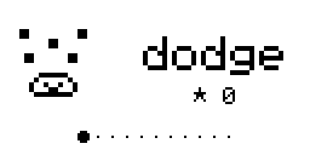 | 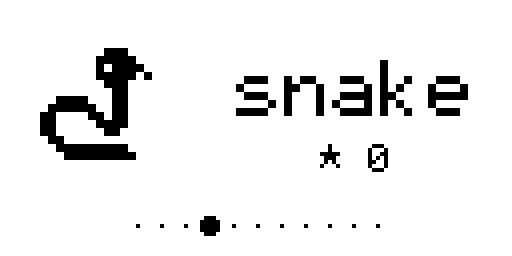 |

It has a light, cute look: dark ink on a lit screen, pixel-art icons, hearts and stars, and very
few words. (The Nano's screen has one color, so "light" is as pink as it gets.)

## What it is (and why it is an app, not an OS)

The Nano S Plus runs Ledger's OS (BOLOS) on a secure chip that only boots firmware signed by
Ledger. Nobody can replace that OS. What the device does allow is **sideloading your own apps**,
and that is what Badge Arcade is. It opens straight into a launcher with the games,
and from there it's the only thing you use. Ledger's OS stays underneath and handles the PIN and
the lock screen.

The app asks for no key derivation at all (no curve, no path), so it cannot read or use anything
in the wallet, even when the device holds funds.

## The games

| | BadgeOS | On the Nano S Plus |
|---|---|---|
| **Dodge** | Dodge falling blocks, the speed rises, high score saved. A shop sold a shield, a sword and paint for tokens. | Same game, scaled to 128 × 64. The shop is gone, because it was the wallet part. The high score is saved in the app's flash. |
| **Dice** | Roll 1 to 5 dice with the hardware random generator, tumble animation, total. | Same, using the secure element's true random generator. |
| **Duel** | Two badges, a reaction duel over the ESP-NOW radio, and the loser pays a stake. | The Nano has no radio, so it's a **two-player duel on one device**: the left player uses the left button, the right player the right one. Best of 3, a false start loses the round, and there's no stake. |

| Dodge | Dice | Duel |
|---|---|---|
| 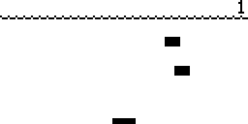 | 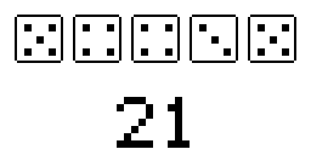 |  |
| 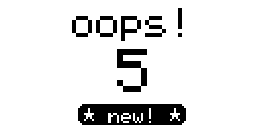 | 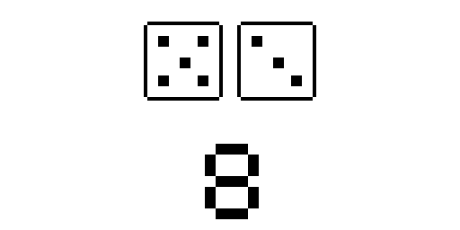 | 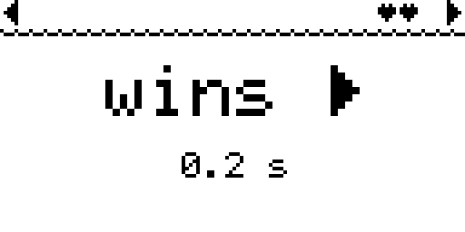 |

### The arcade's own games

All seven were made for two buttons and the 128 × 64 screen. The ones with a score keep their best
in the app's flash.

| | How to play |
|---|---|
| **Snake** | The snake crawls on its own. LEFT and RIGHT turn it to its own left and right. Food makes it longer and faster; walls and its own body end the run. |
| **Pong** | First to 5. LEFT picks **1p**, RIGHT picks **2p**, both buttons start. **1p**: hold LEFT to move up, RIGHT to move down, against the device. **2p**: one button each; your paddle slides on its own and a press turns it around. |
| **Bricks** | Hold LEFT or RIGHT to move the paddle. Where the ball lands on the paddle sets its angle. Three balls, four walls that repeat faster. |
| **Racer** | Three lanes, traffic coming at you. LEFT moves up a lane, RIGHT down. The road speeds up; the score is the distance. |
| **Cave** | Hold one button to climb, let go to sink, through a winding cave that narrows, with rocks in the way. |
| **Flip** | Press to flip gravity and run on the ceiling or the floor. Dodge spikes and holes on both sides; you can only flip with your feet down. |
| **Runner** | A night run over the rooftops: RIGHT jumps (hold for higher), hold LEFT to duck (or drop faster in the air). Jump crates, duck low bats, grab coins. |

| Snake | Pong | Bricks |
|---|---|---|
| 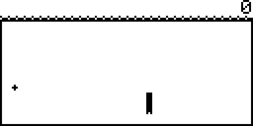 | 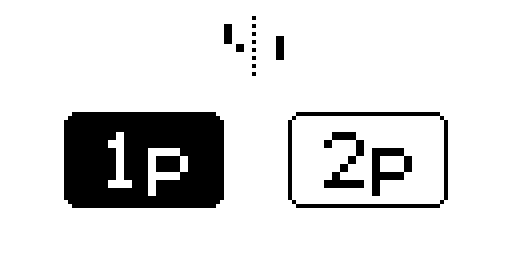 | 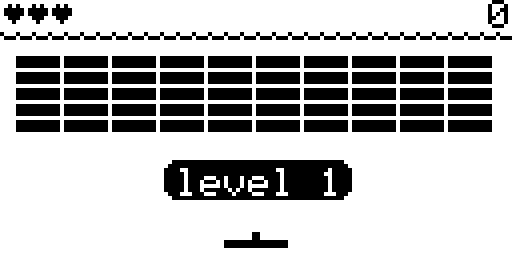 |
| **Racer** | **Cave** | **Flip** |
| 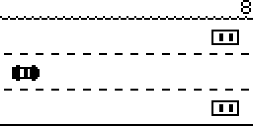 | 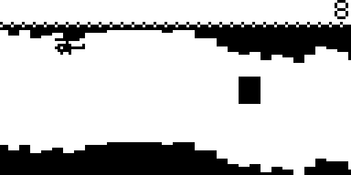 | 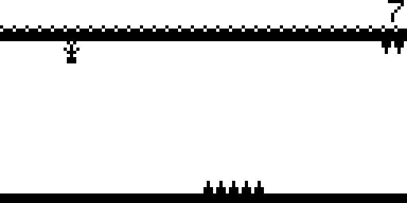 |
| **Runner** | **Paused** | **Pong** |
| 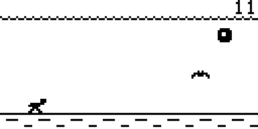 | 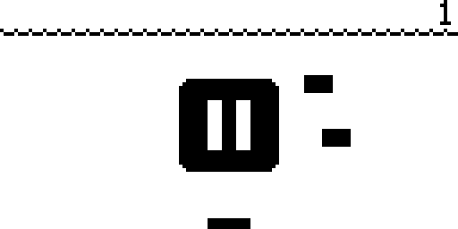 | 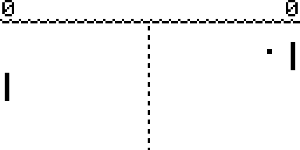 |

The screens don't spell out the controls, so here they are. Opening a score game starts a 3, 2, 1
countdown and then the run. Both buttons pause (a pause sign) and resume, and holding both goes back
to the launcher. When the run ends, "oops!" shows your score and your best (★), with a "new!" when
you beat it. Both buttons play again.

The screen updates 10 times a second, like the other games (the device's own timer).

## Controls

The Nano has two buttons. Pressing both stands in for the badge's other keys:

| Do this | Meaning (BadgeOS key) |
|---|---|
| Left / right | Move, previous / next, fewer / more dice |
| **Both, quick press** | SELECT: open, play again, roll, start, pause |
| **Both, hold ~1 s** | CANCEL: back to the launcher (on the launcher, or its last card, *bye!*, it quits to the Ledger dashboard) |

In **Duel**, each player presses only their own button: the left player presses left, the right
player presses right. Wait for the screen to light up.

## Put it on your Nano S Plus

You need a Mac with **Docker Desktop** and **Python 3**, plus **Ledger Live** (only for the
firmware update).

1. **Set up the device**, if it's new. Ledger's OS won't run any app until the device has a PIN
   and a recovery phrase. Choose a PIN and write the phrase down; the games never touch it.

2. **Update the firmware.** Open Ledger Live → *My Ledger*, plug in, and install any update. Note
   the firmware version shown there. Then **quit Ledger Live** completely, because it holds the USB
   connection while open.

3. **Build** the app (the first run downloads Ledger's ~3 GB build image):
   ```sh
   ./scripts/build.sh
   ```
   This builds for the newest firmware. If *My Ledger* showed firmware **1.6.0**, build with
   `API_LEVEL=26 ./scripts/build.sh` instead. The app has to match the firmware or the device
   refuses it.

4. **Plug in the Nano S Plus, unlock it with your PIN, and stay on the dashboard.**

5. **Install:**
   ```sh
   ./scripts/load.sh
   ```
   The device will ask you to **allow an unsafe manager**. That's normal for any app not
   installed through Ledger Live, so approve it (both buttons). It then shows the app's name and a
   hash and asks you to confirm the install; approve again.

6. **Play.** On the dashboard, scroll to **Badge Arcade** and press both buttons. Every launch
   first shows **"This app is not genuine"**, because Ledger didn't sign it. Continue past it to
   reach the launcher.

To uninstall it: `./scripts/load.sh remove` (with the device unlocked on the dashboard).

### If something goes wrong

| Message | Fix |
|---|---|
| `Invalid status 5515 (Did you unlock the device?)` | Enter the PIN and go back to the dashboard. |
| `No dongle found` / the device is busy | Quit Ledger Live, unplug and replug. |
| The install is refused right after you approve it | The build doesn't match the firmware. Update the firmware (step 2) and rebuild, or build for your firmware's API level (step 3). |
| `Invalid status 6985` | You rejected one of the prompts on the device. Run it again and approve. |
| Not enough space | Remove an app you don't use (in Ledger Live), then install again. |

The high score lives in the app's own storage. It survives turning the device off, but it's
reset when the app is reinstalled.

## Try it without the device

[Speculos](https://github.com/LedgerHQ/speculos) is Ledger's emulator; it runs the exact
`bin/app.elf` that goes on the device.

```sh
./scripts/emulate.sh          # then open http://localhost:5001: the screen and two buttons
./scripts/emulate.sh test     # the automated tests: every game, driven through the buttons
./scripts/emulate.sh tour     # a screenshot of every screen, in screenshots/
```

## How it works

```
src/main.c      the event loop. Every event goes to Ledger's OS first, so the PIN and lock screens
                keep priority; then the arcade reads the raw button state.
src/gfx.c       a 128 x 64, 1-bit framebuffer shown as one full-screen NBGL image, in a light
                theme (dark ink on a lit screen); a 5 x 7 font with lower case; sprites, bubbles
src/ui.c        the look: the score bar with its lace edge, bubbles, the best score's star
src/icons.c     the launcher's 16 x 16 pixel-art icons
src/run.c       a score game's life: countdown, play, pause, crash, oops!, best score
src/input.c     two buttons -> LEFT, RIGHT, SELECT (both), BACK (hold both), plus raw presses
src/shell.c     the launcher and the app switch
src/dodge.c     ported from BadgeOS apps/game/main.lua
src/dice.c      ported from BadgeOS apps/dice/main.lua
src/duel.c      ported from BadgeOS apps/duel/main.lua (hot-seat instead of radio)
src/snake.c, pong.c, bricks.c, racer.c, cave.c, flip.c, runner.c   the arcade's own games
```

The games run on the OS's 100 ms ticker (10 updates a second), and a button press is handled the
instant it arrives. When the device locks mid-game, the game pauses.

Built with Ledger's C SDK (API level 27) in the official `ledger-app-dev-tools` image.
