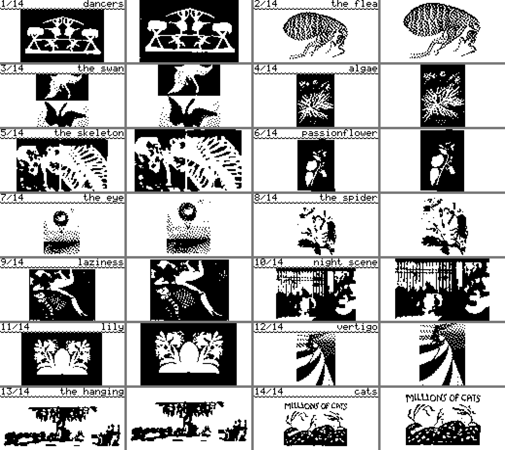
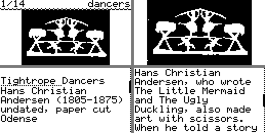

# Curio

A pocket gallery for the **Ledger Nano S Plus**: fourteen works of art that are interesting rather
than famous, each in black and white with its artist and the story behind it. It's an app of its
own, built on the same core as [Badge Arcade](../README.md). Like the arcade, it asks for no key
derivation, so it can't read or use anything in the wallet.



## How it works on the device

| | |
|---|---|
| **The card** | One work at a time: its number and a short title in the bar, the whole work under it. LEFT and RIGHT turn through the works, BOTH opens one, holding both quits. |
| **The work** | Its pages: first the whole work, as big as the screen allows; for most works, a closer look at the part that matters; then the title, artist and date; then the story. LEFT and RIGHT turn the pages, and going past either end returns to the card. BOTH or holding both returns at once. |

The bar on the right of the text pages shows where you are in the work. Curio reopens on the last
work you looked at.



## The works

| | Work | Artist |
|---|---|---|
| 1 | Tightrope Dancers, paper cut | Hans Christian Andersen |
| 2 | Of a Flea, from *Micrographia* (1665) | Robert Hooke |
| 3 | The Swan, No. 1 (1915) | Hilma af Klint |
| 4 | *Dictyota dichotoma*, cyanotype (1843) | Anna Atkins |
| 5 | Takiyasha the Witch and the Skeleton Spectre (c. 1844) | Utagawa Kuniyoshi |
| 6 | *Passiflora laurifolia*, paper collage (1777) | Mary Delany |
| 7 | The Eye, Like a Strange Balloon, Mounts Toward Infinity (1882) | Odilon Redon |
| 8 | Spiders, ants and a hummingbird (1705) | Maria Sibylla Merian |
| 9 | Laziness, woodcut (1896) | Félix Vallotton |
| 10 | Night Scene in the Yoshiwara | Katsushika Ōi |
| 11 | Lily, paper cut (1804-1806) | Philipp Otto Runge |
| 12 | Vertigo (1908) | Léon Spilliaert |
| 13 | The Hanging, from *The Miseries of War* (1633) | Jacques Callot |
| 14 | *Millions of Cats* (1928) | Wanda Gág |

Every picture is public domain (or CC0) and comes from Wikimedia Commons. [CREDITS.md](CREDITS.md)
links each source. The screen's font has no macron, so Katsushika Ōi appears as "Oi".

## Making the pictures readable in 1 bit

The screen is 128 × 64 pixels with one color, so a picture only survives if its important part is
big and its shapes are clear. That's why the gallery leans on works that were already close to
black and white: paper cuts, woodcuts, cyanotypes, engravings and collages on black.

Each work in [works.json](works.json) has views. A view is a crop, as fractions of the picture,
rendered one of two ways:

- **dither** (Atkinson): keeps tones, for the flea, the eye and Vertigo.
- **threshold**: keeps shapes, for paper cuts and woodcuts. A **blur** first turns fine hatching
  into tone, so an engraving becomes masses instead of static.

The first view is the whole work: fitted under the bar on its card, and as big as the screen
allows on its first page. The others are closer looks, fitted to the screen in their own
proportions. Only the ones marked `fill` are cropped to fill the screen, and only where that crop
is still a gentle zoom.

## Adding or changing a work

1. Add it to [works.json](works.json): the Commons file, a short title (15 characters at most),
   the about lines, the story and the views. Texts must stay within the font: ASCII, plus é and á.
2. Rebuild the pictures and texts, then look at the preview:
   ```sh
   docker run --rm -v "$PWD:/app" -w /app ghcr.io/ledgerhq/ledger-app-builder/ledger-app-dev-tools:latest \
     python3 tools/make_gallery.py gallery/sources/preview.png
   ```
   This fetches any missing picture into `gallery/sources/` (not committed), writes
   `gallery/src/works.c` and `CREDITS.md`, and wraps the texts to the screen's 20 characters a line.
3. Build, try it and install it, as below.

## Put it on your Nano S Plus

The same steps as [Badge Arcade's](../README.md#put-it-on-your-nano-s-plus), with `gallery` added:

```sh
./scripts/build.sh gallery      # API_LEVEL=26 ./scripts/build.sh gallery for firmware 1.6.0
./scripts/load.sh gallery       # then approve on the device; ./scripts/load.sh gallery remove to uninstall
```

On the dashboard it's **Curio**. Every launch first shows "This app is not genuine", like the
arcade: continue past it.

## Try it without the device

```sh
./scripts/emulate.sh gallery          # then open http://localhost:5001
./scripts/emulate.sh gallery test     # the automated tests
./scripts/emulate.sh gallery tour     # every card and detail, in screenshots/
```

## The files

```
gallery/works.json         the works: sources, crops, texts
tools/make_gallery.py      works.json -> gallery/src/works.c (and CREDITS.md)
gallery/src/gallery.c      the app: cards, pages, drawing, the last work seen in flash
gallery/src/works.h        the format of works.c: offsets into one block of pictures and one of text
gallery/Makefile           its name (Curio), icon and storage; the core comes from ../src
```
