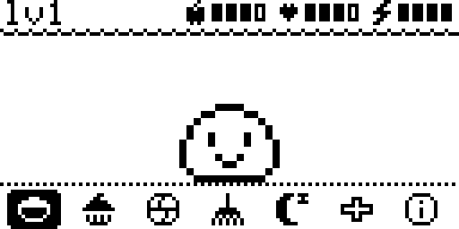
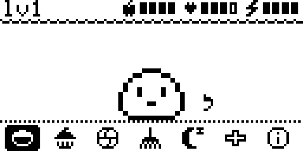
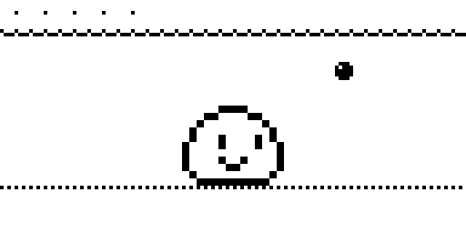
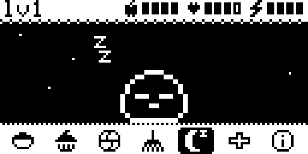
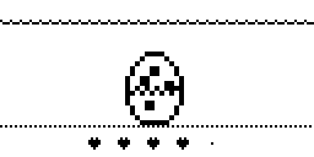
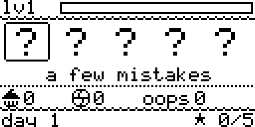
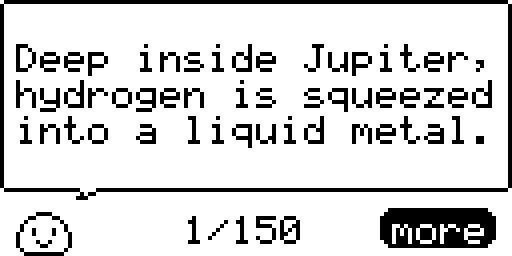
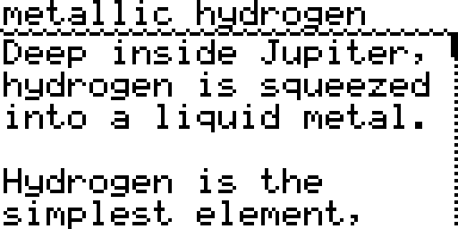

# Mochi

A little creature to raise on a **Ledger Nano S Plus**, from an egg to a grown-up. An app of its
own, built on the same core as [Badge Arcade](../README.md): the same light, cute look, two
buttons, no keys. Like the arcade, it asks for no key derivation, so it can't read or use anything
in the wallet.

It opens straight into the pet's room. Its egg hatches after 20 seconds, or sooner if you tap it
(any button).

| | |
|---|---|
|  |  |
|  |  |
|  |  |

The bar shows its level and three meters: food, fun and energy. A meter blinks when it runs low,
and a bubble over the pet shows the action it needs. LEFT and RIGHT move along the shelf, BOTH
does the action, and **holding both** saves and goes back to the Ledger dashboard:

| | |
|---|---|
| **meal** | Fills food. A full pet refuses. |
| **treat** | A bit of food and a lot of fun. Three in a row without a meal give it a tummy ache. |
| **play** | A game of catch: five balls come from the left or the right. Press that side's button just as the ball reaches the pet. Pressing too soon or the wrong side drops it. It costs energy. |
| **clean** | Clears the poop off the floor. |
| **sleep** | Lights off until its energy is full (or lights on again). |
| **meds** | Cures it when it's sick. |
| **info** | Its level, what it has eaten and caught, its mistakes, and the collection (LEFT and RIGHT browse it, BOTH goes back). |

**Physics facts.** After every action that works (a meal, a treat, a game of catch, a clean, meds,
lights off or on), once its little scene is over, the pet tells you a physics fact in a speech box.
There are 150, on quantum physics, particles, matter, light, relativity and the cosmos (quantum
dots, tunneling, Bose-Einstein condensates, neutron stars, Hawking radiation and the like), written
for someone with no physics background. Press BOTH, as if clicking the box, to open it: the concept
is in the bar, and the fact is explained from scratch over a few pages. LEFT and RIGHT turn the
pages; past the last one, or with BOTH, you're back in the room. LEFT or RIGHT on the box closes it
unread. The pet waits while a fact is on screen (its meters stand still), and it goes through all
150 facts before it tells one again.

| | |
|---|---|
|  |  |

**Growing up.** Every half minute spent fed, happy, rested, clean and well earns experience. So
do meals when it's hungry, games of catch and cleaning up. It's a baby at levels 1-2, a kid at
3-5, a teen at 6-7 and a grown-up at 8-10. Which grown-up it becomes depends on how it was
raised:

| Form | How |
|---|---|
| grump | many mistakes (5 or more) |
| chonk | more cake than meals (8+ treats) |
| zoomie | plays a lot (50+ catches) |
| angel | never a mistake |
| fluff | a few mistakes |

A mistake is letting a meter run empty, letting it collapse from exhaustion, or letting it get
sick. It gets sick from a minute of hunger, a minute with poop on the floor, or too many treats.
If it stays sick for three minutes, it runs away.

**The goal.** When the grown-up completes level 10, it says goodbye and sets off, its form gets a
star in the collection, and a new egg arrives. Collect all five. A careful player raises one in
about half an hour.

**Time.** The device has no clock, so the pet lives only while its app is open. When you quit it
or the device locks, it waits exactly as you left it. It's saved in the app's flash when you leave,
when the device locks, every two minutes, and at every step of its life.

## Put it on your Nano S Plus

The same steps as [Badge Arcade's](../README.md#put-it-on-your-nano-s-plus), with `pet` added:

```sh
./scripts/build.sh pet          # API_LEVEL=26 ./scripts/build.sh pet for firmware 1.6.0
./scripts/load.sh pet           # then approve on the device; ./scripts/load.sh pet remove to uninstall
```

On the dashboard it's **Mochi**, next to Badge Arcade. Like the arcade, every launch first shows
"This app is not genuine": continue past it. Reinstalling resets the pet.

## Try it without the device

```sh
./scripts/emulate.sh pet          # then open http://localhost:5001
./scripts/emulate.sh pet test     # the automated tests
./scripts/emulate.sh pet tour     # a screenshot of every screen, in screenshots/
```

## How it works

```
pet/src/pet.c   the pet: its life (a tick of 100 ms, a second of meters), the shelf, catch, the
                room, the info page, the facts and the goodbyes; the pictures are 1-bit sprites
pet/src/app.c   the app around it: the shell the core calls, and the pet in the app's flash
pet/facts/      the physics facts, by topic: a title, the fact, and the paragraphs explaining it
pet/src/facts.c made from them by tools/make_facts.py (python3 tools/make_facts.py), which wraps
                the texts to the screen and checks that each fact fits its box
pet/Makefile    its name, icon and storage; the core comes from ../src (see src/core.h)
```
